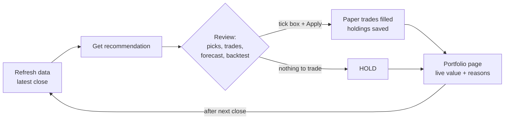
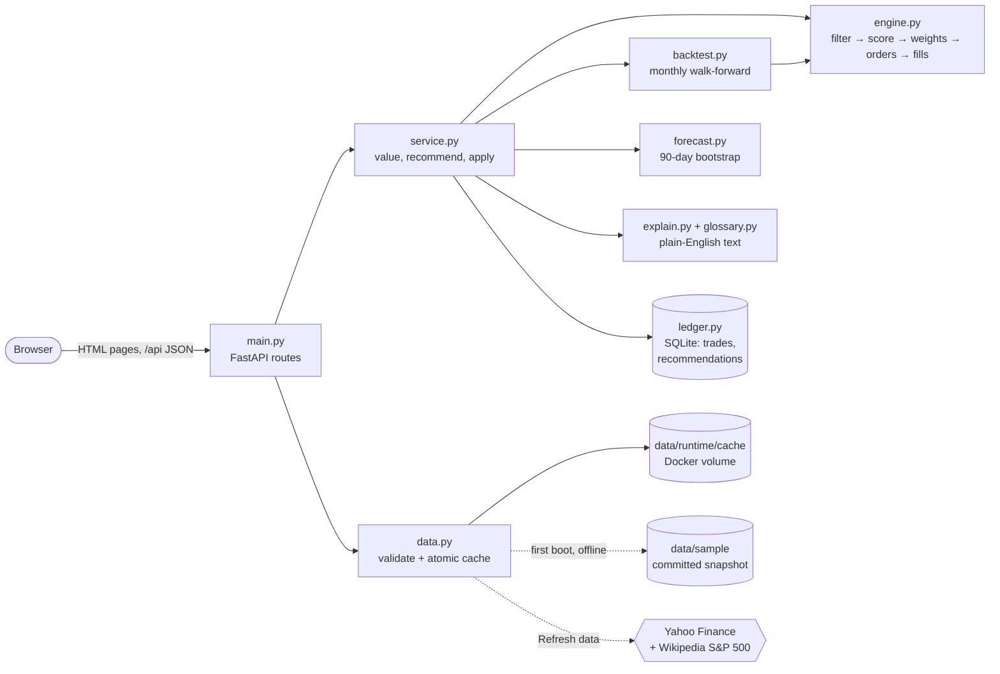

<div align="center">

# YAMS · Yet Another Market Simulator

**Invest fake. Learn real.**

A paper-money stock portfolio that tells you what to buy, why, and what might happen next.


</div>

---

Start with $1,000 of fake money. YAMS scores the S&P 500, builds a capped portfolio, backtests the rules against SPY,
forecasts 90 days ahead, and explains every pick in plain English. No broker, no real trades.

> **Proof of concept** (~4 h) of the larger design in [`docs/archive/`](docs/archive/).
> Build spec: [`docs/SPEC.md`](docs/SPEC.md). What was cut: [Tradeoffs](#tradeoffs).

## Quick start

```bash
docker compose up --build        # → http://localhost:8000
```

- Works offline. A Yahoo Finance snapshot ships in `data/sample/`. No API keys.
- Your portfolio is kept in a Docker volume. It survives restarts; `docker compose down -v` wipes it.

<details>
<summary>Without Docker (needs <a href="https://docs.astral.sh/uv/">uv</a>)</summary>

```bash
uv sync
uv run uvicorn app.main:app --port 8000
uv run pytest                    # 29 tests, no network
```
</details>

## How to use it



| Page | What you get |
|---|---|
| **Portfolio** | Holdings, value vs SPY, and a *next step* card. Live prices while the market is open (display only). |
| **Recommendation** | Apply button up top. Then: picks with reasons, trades, 90-day forecast (range bars + fan chart, apply vs keep), track record, close calls. |
| **Backtest** | Pick a start date. Metrics, value and drawdown charts vs SPY, assumptions. |

- Every metric has a **?** with a plain-English explanation.
- **Refresh data** after the market closes (~1 min, needs internet).
- Recommendations propose *changes* to what you hold. Small drifts are left alone.

<details>
<summary>JSON API</summary>

| Method | Path |
|---|---|
| `GET` | `/api/status` |
| `GET` | `/api/portfolio` |
| `POST` | `/api/recommendations` |
| `POST` | `/api/recommendations/{id}/apply` |
| `GET` | `/api/backtest?start=YYYY-MM-DD` |
| `POST` | `/api/data/refresh` |
| `POST` | `/api/portfolio/reset` |
</details>

## How it picks stocks

**Risk-adjusted momentum:** own the S&P 500 stocks that rose most steadily, spread out and capped. Go to cash when the
market turns down. Rules were fixed before any backtest. Full rationale: [`docs/STRATEGY.md`](docs/STRATEGY.md).

| Step | Rule |
|---|---|
| Filter | Today's S&P 500. ≥ 1 year of prices, ≥ $5, ≥ $10M traded per day, above 200-day average |
| Score | `0.60·z(6-mo return) + 0.25·z(3-mo return) − 0.15·z(volatility)` |
| Build | Top 8, max 3 per sector. Calmer stocks get more weight. **≤ 20% per stock, ≤ 40% per sector, ≥ 5% cash** |
| Risk-off | SPY below its 200-day average → **≥ 50% cash** |
| Costs | 0.10% slippage per trade. Skip trades under $5 or under 2 points of drift. Fractional shares |
| Backtest | Monthly. Decide at the close, fill at the **next open**. Same engine as live |
| Forecast | 2,000 simulated 90-day futures from the last year, in 5-day blocks. Each stock's trend reset to SPY's |

**Backtest on the bundled data (3 years, $1,000):** strategy **$4,700** vs SPY **$1,900**. Worst drop **−33%** vs **−19%**.
Inflated by survivorship bias. Treat it as an upper bound.

## Architecture

Python 3.12 · FastAPI · Jinja2 · Chart.js · pandas/NumPy · yfinance · SQLite · pytest · Docker.
One process. No build step. No external services.



- Money is `Decimal`. Holdings and cash come from the trade ledger.
- A recommendation applies **once**. It's rejected (409) if your portfolio or the data changed since.
- Refresh fails safely: if a held stock or SPY can't download, the old data stays.

## Tradeoffs

| Chose | Instead of | Cost |
|---|---|---|
| One process, SQLite, server pages | Postgres, worker, Next.js | No scale, single user |
| Click to evaluate | Scheduled daily runs | "Ongoing" only when you click |
| Today's S&P 500 in the backtest | Historical index membership | **Survivorship bias flatters results** |
| Caps, cash buffer, trend switch | Stop-losses, volatility targeting | Worst drop (−33%) deeper than SPY's (−19%) |
| Prices, sectors, market trend | Fundamentals, earnings, news | Less context |
| Bootstrap forecast | Forecasts checked against outcomes | Ranges are honest but unvalidated |
| Live fills at last close | Pending next-open orders | Simpler; the backtest still uses next-open |
| yfinance + 9 MB snapshot | Licensed data | Unofficial, personal-use terms |
| One portfolio, one strategy | Strategy Lab, Arena, many portfolios | Out of scope |

How the POC grows into the full design: [`docs/FUTURE.md`](docs/FUTURE.md).

<details>
<summary>Small print</summary>

- Prices are split- and dividend-adjusted, so dividends count as reinvested. Cash earns 0%.
- Live intraday prices are display-only and never drive decisions. `YAMS_LIVE_QUOTES=0` turns them off.
- Regenerate the sample snapshot: `uv run python scripts/make_sample.py`.
</details>

---

<div align="center"><sub>Paper money only. Not investment advice.</sub></div>
