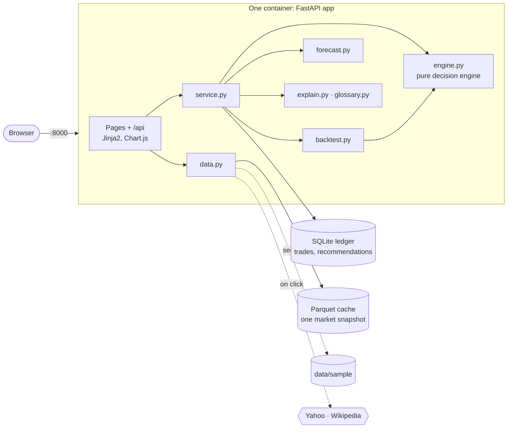
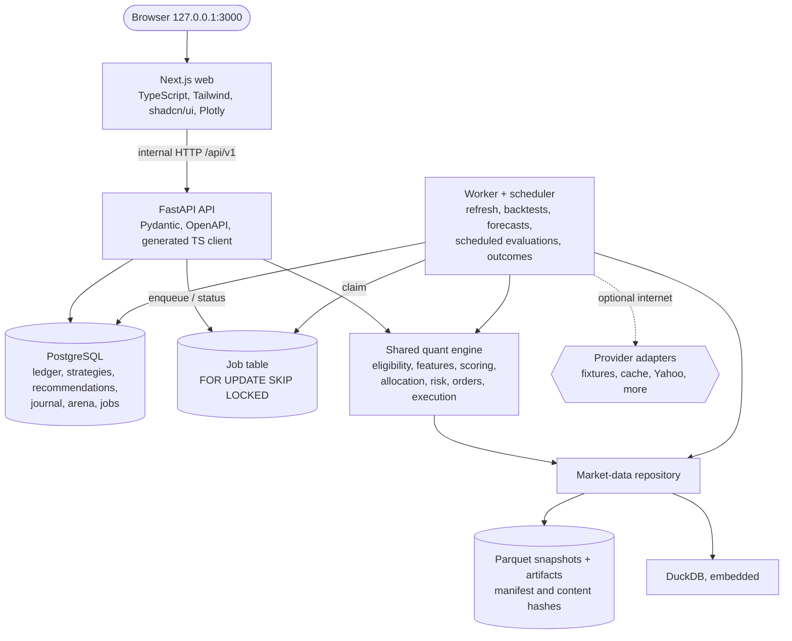
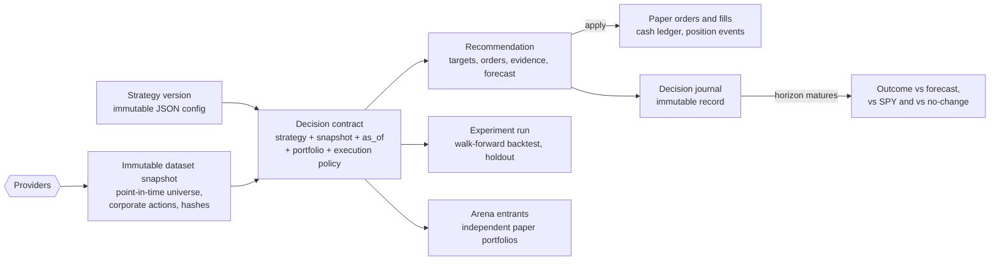
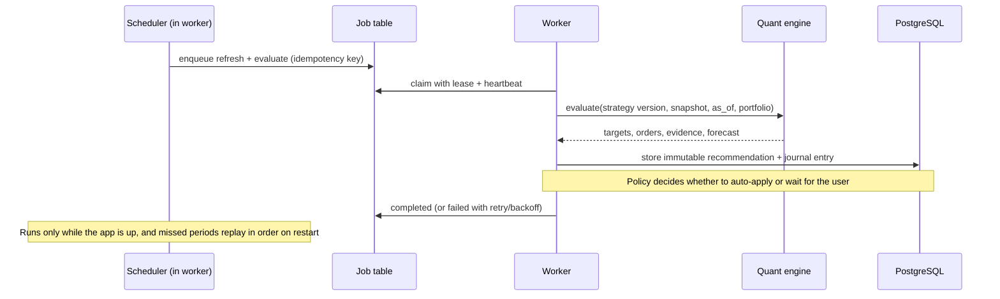
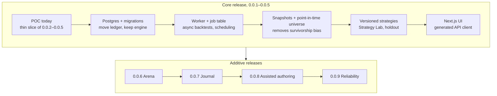

# From POC to target architecture

YAMS today is a **proof of concept**: one process that delivers the whole decision loop (data → picks → trades →
forecast → backtest → paper ledger) in the simplest runnable form. The **target state** is the fuller local research
product described in [`archive/`](archive/), mainly `TECHNOLOGY_STRATEGY.md`, `PRODUCT_STRATEGY.md` and
`IMPLEMENTATION_BLUEPRINT.md`. This page compares the two and shows how the POC grows into the target without a rewrite.

Both share the same principles: **paper money only**, runs on one machine with `docker compose up`, no accounts, no
brokers, no cloud, and **one shared decision engine** used by live recommendations and backtests alike.

## Current: POC (this repository)

Everything runs in the request: a recommendation (scoring 500 stocks, a 3-year backtest and 2,000 forecast paths)
takes well under a second (about 0.5 s cold, cached after), so no job queue is needed. State is one SQLite file plus one cached market snapshot, both on a
Docker volume.

## Target: full design

Four long-running containers (`web`, `api`, `worker`, `postgres`) and a one-shot migration task. Only the web port
is published, on loopback.

### Target data and decision flow

### Target scheduled evaluation

## Side by side

| Concern | POC (now) | Target | Why it matters |
|---|---|---|---|
| Deployment | 1 container | 4 containers + migration task | Heavy work leaves the request path |
| UI | Server-rendered Jinja2 + Chart.js | Next.js, Tailwind, shadcn/ui, Plotly | Richer interactive research and comparison |
| Durable state | SQLite: trades + recommendations | PostgreSQL + Alembic migrations, full domain model | Many portfolios, strategies, journal, arena |
| Market data | One Parquet cache, overwritten on refresh | Immutable, hashed snapshots + DuckDB | Reproducible experiments; provenance |
| Universe | **Today's** S&P 500 | **Point-in-time** membership and corporate actions | Removes survivorship bias from backtests |
| Strategies | One, fixed in `config.py` | Versioned JSON configs, Strategy Lab, templates | Test ideas without code changes |
| Evaluation | When the user clicks | Scheduler + job queue, catch-up on restart | Truly ongoing decisions |
| Backtests | In-request, 3-year window | Async jobs, in-sample vs **untouched holdout** | Honest validation, larger experiments |
| Forecast | Bootstrap scenario | Same baseline + **journal tracks realized outcomes** and calibration | Know whether forecasts deserve trust |
| Competition | — | Strategy Arena: frozen entrants, equal capital | Fair forward comparison of strategies |
| Context data | Prices, sectors, market trend | Provider interface for fundamentals and events, with availability dates | Richer, point-in-time signals |
| Fills | Last close ± slippage | Explicit execution policy, unadjusted fill prices, pending orders | More realistic paper trading |
| Quality | pytest (29 tests) | pytest + Vitest + Playwright, CI, release pipeline | Safe parallel development |

## What carries over unchanged

The POC was built so that its core survives the move:

- **`engine.py`** is already the target's "single decision contract": pure functions from prices, sectors, holdings
  and parameters to targets, orders and fills, shared by live and backtest. It moves into the quant-engine package as is.
- **Decimal ledger semantics**: holdings derived from trades, immutable recommendations, and apply-once with a 409 on
  stale state map directly onto the target's paper orders, fills and idempotency rules.
- **Explanations from numbers** (`explain.py`, `glossary.py`) stay deterministic: no LLM computes results.
- **Forecast method** (bootstrap, same paths for proposed vs hold, drift adjustment) is the target's stated baseline.
- **API shapes** (`/api/recommendations`, `/apply`, `/backtest`, error envelope) move under `/api/v1`.

## Migration path

Order of value: **Postgres + worker** first (unblocks scheduling), then **point-in-time data** (fixes the biggest
credibility gap), then **strategy versioning**, then the **new UI**. The Arena, Journal, assisted authoring and
reliability milestones are additive after the core release.
