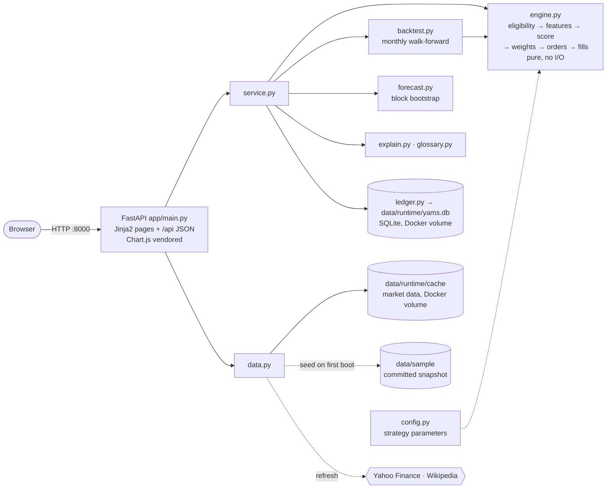
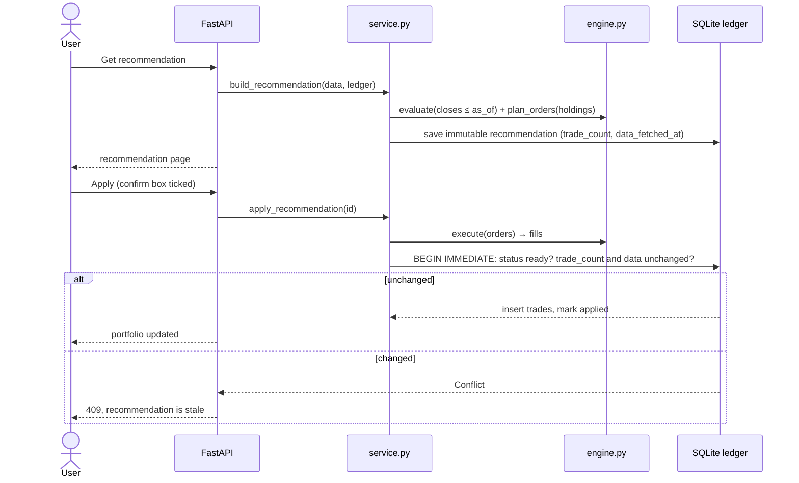

# YAMS — Build Specification

**Yet Another Market Simulator** · *Invest fake. Learn real.*
**Status:** Single source of truth for the build · **Updated:** 2026-10-28
**Time box:** ~4 hours, one shot. If a feature is not in this document, it is out of scope.

> Paper money only. Market data is real (Yahoo Finance); every dollar, order and fill is simulated.
> Nothing here is investment advice.

---

## 1. Goal

A small web app that starts with **$1,000 of fake money** and answers, every time you ask it:

1. **What should I own now?** A concrete set of holdings and weights, derived from data
   (not a fixed allocation, not a hand-picked list).
2. **Why?** A plain-English reason for every position, and for every buy, sell or hold.
3. **What changes should I make, and what do they do to my expected outcome?** Specific
   trades plus a numerical 90-day return forecast for the proposed portfolio vs. doing nothing.
4. **Would this have made money before?** A historical backtest of the exact same rules
   against simply holding SPY, shown *before* you apply the recommendation.

You can apply the recommendation to the paper portfolio; holdings and cash persist, and the
next time you ask, the app recommends changes relative to what you actually hold.

### Requirement → feature map

| Original requirement | Where it is met |
|---|---|
| Data-driven, ongoing decisions; no fixed/hand-picked list | Rule-derived S&P 500 universe → filters → scores (§4) re-run on every evaluation |
| Hold a position it will defend | Persistent paper portfolio + per-position explanations (§5, §7) |
| Forward-looking recommendation with forecast over a stated horizon | Trade list + 90-calendar-day bootstrap forecast, proposed vs. hold (§6) |
| Ingest price and contextual data | Yahoo Finance OHLCV + GICS sector + market-regime context (§3) |
| Score candidates, construct under constraints | §4.2–4.3 |
| Explain to a non-specialist | Template explanations from computed numbers (§7) |
| Historical check before recommending | Walk-forward backtest vs SPY on the recommendation page (§5) |
| Risk management and real-world considerations | §4.4 |
| No real money | No broker code, no order routing; ledger is a local SQLite file |

## 2. Scope

**In scope**
- One strategy (Risk-Adjusted Momentum) with fixed, documented parameters.
- One paper portfolio, resettable with a chosen starting cash (default $1,000).
- Data refresh from Yahoo Finance, with a committed sample snapshot so the app works offline
  and on first boot.
- Recommendation = target portfolio + trades + explanations + forecast + backtest summary.
- Apply recommendation → simulated fills → updated holdings/cash, persisted across restarts.
- History of trades and past recommendations.
- Unit tests for the engine's financial invariants.

**Out of scope (explicitly cut)**
Strategy Lab, forking/versioning, multiple strategies or portfolios, Strategy Arena, Decision
Journal outcome tracking, background job queue/worker, scheduler, PostgreSQL, Parquet
snapshot manifests, Next.js frontend, LLM features, authentication, ADR process, CI/CD
release pipeline, pending next-open fills for the live portfolio, dividend/split ledger
accounting, holdout/parameter-search tooling, short selling, leverage, options.

## 3. Data

| Item | Source | Notes |
|---|---|---|
| Universe | S&P 500 constituents (ticker, name, GICS sector) | Fetched from Wikipedia on refresh; committed copy in `data/sample/universe.csv`. A published, rule-based list, not a hand-picked one. |
| Prices | `yfinance.download(tickers, period="5y", auto_adjust=True)` | Daily Open, Close, Volume for the universe and **SPY**. Prices are split- and dividend-adjusted (see §8). |
| Market context | SPY close vs its 200-day SMA | Drives the risk-off regime rule (§4.4). |

- Cache: `data/runtime/cache/prices.parquet` and `universe.csv`, plus `meta.json` (`as_of` = last
  completed session, `fetched_at`, ticker count, missing tickers).
- **Startup:** use the cache if present, otherwise copy `data/sample/`. Never block startup on the network.
- **Refresh** (`Refresh data` button): download universe + **currently held tickers** + SPY → validate (drop tickers with <252 rows or
  non-positive prices) → write to a temp file → atomic rename. A failed refresh (including any held ticker or SPY missing) keeps the previous cache.
- **Freshness:** always show `Data as of YYYY-MM-DD (sample | live)`. If the data is more than 5
  calendar days old, show a warning (applying trades is still allowed, since this is a simulation).
- Ticker format: Yahoo style (`BRK-B`, not `BRK.B`). Normalize on ingest.

## 4. Strategy: Risk-Adjusted Momentum

All parameters live in `app/config.py` as one frozen dataclass. They were fixed in advance,
**not tuned** on the backtest. This is a transparent baseline, not a claim that it beats the market.

### 4.1 Eligibility (evaluated as of session T, using data ≤ T only)

- At least **252** sessions of history.
- Last close **≥ $5**.
- 20-session median dollar volume (close × volume) **≥ $10M**, as a liquidity filter.
- **Trend filter:** close > SMA(200).
- Sector must be present. A ticker with a missing sector is **excluded** with the reason
  `NO_SECTOR`; there is no "Unknown" bucket.
- Every excluded ticker records a reason code: `SHORT_HISTORY`, `LOW_PRICE`, `ILLIQUID`,
  `BELOW_TREND`, `NO_SECTOR`, `BAD_DATA`.

### 4.2 Features and score

- `M126 = close[T] / close[T-126] − 1` (about 6-month momentum)
- `M63  = close[T] / close[T-63] − 1` (about 3-month momentum)
- `VOL60 = std(last 60 daily log returns, ddof=1) × √252`
- z-scores are taken across the **eligible** set (population, ddof=0). If a feature has zero
  dispersion, its z = 0.
- **Score = 0.60·z(M126) + 0.25·z(M63) − 0.15·z(VOL60)**
  - In config, all three weights are stored as **positive magnitudes**
    (`w_mom_long=0.60, w_mom_short=0.25, w_vol_penalty=0.15`), and the minus sign appears only in
    the formula. Do not store a negative penalty weight.
- Ties are broken by ascending ticker. Rows with any non-finite feature are excluded (`BAD_DATA`).

### 4.3 Portfolio construction

1. Walk down the ranking and take the top **N = 8**, skipping a name when its sector already has
   ⌊8 × 40%⌋ = **3** picks (otherwise the sector cap would strand budget in cash).
2. Raw weight ∝ 1 / VOL60 (inverse volatility).
3. Scale to the **investable budget** = 1 − cash floor (95% normally, 50% when risk-off, §4.4).
4. Apply caps by iterative water-fill: **max 20% per position**, **max 40% per sector**.
   Excess goes to uncapped names; anything that cannot be placed stays in cash.
5. Targets + cash = 1.0 (±1e-9). If nothing is eligible, the target is **100% cash**.

### 4.4 Risk management and real-world frictions

| Concern | Rule |
|---|---|
| Concentration | 20% position cap, 40% sector cap, 8 names |
| Volatility | Inverse-vol weighting; volatility penalty in the score |
| Trend / crash protection | Per-stock SMA(200) filter, plus a **market regime**: if SPY < its SMA(200), cash floor = 50% |
| Liquidity | $5 minimum price, $10M median dollar volume |
| Trading costs | **10 bps slippage per side** applied to every simulated fill; $0 commission |
| Turnover control | **Rebalance band:** skip a trade if |target − current| < 2 percentage points of portfolio value, unless the position must be fully exited (no longer in target) |
| Tiny trades | Skip trades under **$5** notional |
| Fractional shares | Allowed, 6 decimal places; buy quantities are truncated (rounded down) |
| Cash | Never negative; sells execute before buys and their proceeds fund the buys |
| Instruments | Long-only US equities; no margin, shorts or derivatives |
| Look-ahead bias | In the backtest, decide at T close and fill at T+1 **open** |
| Survivorship bias | The universe is *today's* S&P 500, so the backtest is biased upward. This is disclosed on the page |

## 5. Backtest (the historical check)

- **Window:** the last 3 years of the cache by default; the preceding ~1 year is warmup for the 252-session features.
  The backtest page and API accept a `start` date. It is clamped to the warmup at the early end and to at least
  63 sessions at the late end, with a warning. Recommendations always show the default 3-year window.
- **Walk-forward, monthly:** on the last session of each month, run the *same* `engine.evaluate(prices ≤ T)`
  used for live recommendations (shared code, no copy), plan orders with the same band/min-trade
  rules, and fill at the next session's **open** with slippage. Mark to market daily at close.
- **Benchmark:** SPY buy-and-hold with the same starting capital and start date, and the same entry slippage.
- **Metrics:** total return, CAGR, annualized volatility, Sharpe (risk-free = 0), max drawdown,
  number of trades, total costs paid, average monthly turnover. Each is shown for both the strategy and SPY.
- **Charts:** equity curve vs SPY, and drawdown.
- **Caching:** the result is cached in memory keyed by data `as_of`, so it is recomputed after a refresh.
  Target runtime is under 10 seconds on the full universe; vectorize feature computation.
- **Verdict line:** for example, *"Over the last 3 years these rules would have turned $1,000 into
  $1,412 (SPY: $1,355), with a worst drop of −18% (SPY: −24%). Past results, survivorship-biased
  universe, not a guarantee."* The text is generated from the numbers.

## 6. Forecast (forward-looking)

- **Horizon:** 90 calendar days ≈ **62 trading sessions** (90 × 252/365, rounded).
- **Drift adjustment:** stocks are chosen *because* their recent returns were high, so each asset's
  mean daily return is replaced with SPY's mean over the same window (volatility and correlations kept).
  Without this, the forecast replays the selection bias (e.g. +25% median in 90 days).
- **Method:** block bootstrap. Take the last 252 daily return vectors for every asset in either
  the current or the proposed portfolio (plus a zero-return cash column). Sample **5-day blocks**
  of whole rows (keeping assets correlated) to build **2,000 paths** of 62 days. Seed = 42, stored
  with the result.
- **Same paths, two portfolios:** evaluate the **proposed** weights and the **current (hold)**
  weights on identical paths, with constant weights and no further trades. Estimated trade costs
  are deducted up front from the proposed case.
- **Output for each portfolio:** median (P50) return, P10 and P90, probability of loss, and the
  median ending value in dollars. Also the **delta** (proposed − hold).
- **Label it honestly:** *"Scenario based on resampling the last year of returns. Not a
  prediction."* If any held or proposed asset has fewer than 252 returns, the forecast is
  **unavailable** with a reason. Never substitute zeros.

## 7. Recommendation and explanations

`POST /api/recommendations` runs §4 on the latest data, compares the result with current holdings,
and stores an immutable record containing: `id, created_at, data_as_of, regime, target weights,
actions[], forecast, backtest summary, excluded counts by reason, runners_up (next 5 by score)`.

**Actions:** each held or target ticker gets one action:
`BUY` (new) · `INCREASE` · `REDUCE` · `SELL` (full exit) · `HOLD`.
Each action carries the current/target weight, estimated shares and $ notional, estimated cost,
reason codes and explanation text. The portfolio-level summary is one of `REBALANCE`, `HOLD`
(no trade passes the band), or `MOVE_TO_CASH` (empty eligible set).

**Explanations** are deterministic templates filled from computed values (no LLM). Examples:
- Position: *"NVDA (Information Technology) is up 41% over 6 months and 18% over 3 months,
  ranking #2 of 214 eligible stocks. Its price swings (38%/yr) are larger than most picks, so it
  gets a smaller share: 9.8%."*
- Cap: *"…would have received 26%, but no single stock may exceed 20%."*
- Sell: *"Sell XOM: its price fell below its 200-day average, so the trend filter removed it."*
  / *"…now ranks #14; only the top 8 are held."*
- Hold: *"Keep as is: the target differs by only 1.1 points, and trading would cost more than it fixes."*
- Regime: *"The overall market (SPY) is below its 200-day average, so at least half the portfolio is held in cash."*

**Apply:** `POST /api/recommendations/{id}/apply`
- Each fill uses the **latest close in the recommendation's data, plus or minus 10 bps slippage**,
  labeled *Simulated fill*. Sells come first. Buys are resized down if cash would go negative,
  and skipped if under $5.
- One SQLite transaction writes all trades and sets the recommendation status to `applied`.
- **Rejected with 409** if the recommendation is already applied, if any trade happened after it
  was created, or if the data has been refreshed since. The UI then asks you to re-run.
  Because of this, a double click cannot apply twice.

## 8. Simplifications we accept (disclosed in README and UI)

- **Adjusted prices everywhere.** Backtest fills, live fills and valuation all use Yahoo's
  auto-adjusted prices. Dividends are therefore approximated as reinvested price return, and no
  split or dividend ledger is needed. Live holdings are marked at the latest close, where
  adjusted and raw prices are equal.
- **Intraday quotes are display only.** The dashboard and `GET /api/portfolio` add a `live` block that values
  holdings and SPY at Yahoo 1-minute quotes newer than the last close, with today's change. Quotes are cached
  for 60 s and fall back to closes when offline or disabled (`YAMS_LIVE_QUOTES=0`). Scoring, recommendations
  and fills never use them.
- **Live fills happen at the last close**, not the next open. This keeps the app synchronous with
  no pending-order state. The backtest still uses next-open fills to avoid look-ahead bias.
- **Today's S&P 500 is used as the universe** in the backtest (survivorship bias).
- There is no out-of-sample holdout. Instead, parameters are fixed a priori and documented, not tuned.
- The data source is unofficial (yfinance) and intended for personal or educational research.

## 9. Architecture



Recommend and apply (the state-changing path):



- **Stack:** Python 3.12, `uv`, FastAPI, Jinja2, pandas, NumPy, yfinance, pyarrow, SQLite
  (stdlib), pytest. There is no Node toolchain.
- **Money:** `Decimal` for cash, prices and quantities in the ledger (stored as TEXT; cash to cents,
  shares to 6dp). Floats are used only for research statistics (scores, returns, forecasts).
- **Ledger:** `portfolio(id=1, initial_cash, created_at, spy_start_price, start_as_of)`, `trades(id, created_at, rec_id,
  ticker, side, qty, price, cost, cash_delta)`, `recommendations(id, created_at, data_as_of,
  status, payload_json)`. Holdings and cash are **derived** from trades and never stored separately.

### Repository layout

```text
app/  main.py config.py data.py engine.py backtest.py forecast.py explain.py glossary.py ledger.py service.py
      templates/ static/ (chart.umd.min.js, charts.js, style.css)
docs/ SPEC.md (this file)  STRATEGY.md (plain-English strategy)  archive/ (superseded full design)
data/sample/  universe.csv prices.parquet meta.json
scripts/make_sample.py      regenerates data/sample from yfinance
tests/                      engine, backtest, forecast, ledger
Dockerfile  compose.yaml  pyproject.toml  uv.lock  README.md
```

## 10. API

| Method & path | Purpose |
|---|---|
| `GET /` | Dashboard page |
| `GET /recommendations/{id}` | Recommendation page |
| `GET /backtest` | Backtest page, optional `?start=YYYY-MM-DD` |
| `GET /api/status` | Data `as_of`, source (`sample`/`live`), staleness, ticker count |
| `POST /api/data/refresh` | Synchronous refresh (~1 min); returns new status or error |
| `GET /api/portfolio` | Cash, holdings (qty, price, value, weight), total, P&L vs initial, plus a `live` intraday block |
| `POST /api/portfolio/reset` | `{initial_cash}` (default 1000). Wipes trades and recommendations |
| `POST /api/recommendations` | Compute and store a recommendation, return it |
| `GET /api/recommendations` | List (newest first) |
| `GET /api/recommendations/{id}` | One recommendation |
| `POST /api/recommendations/{id}/apply` | Apply as simulated trades. 409 on stale or applied |
| `GET /api/backtest` | Metrics + daily equity series (strategy, SPY). Optional `?start=YYYY-MM-DD` |

Errors are returned as `{"error": {"code": "...", "message": "..."}}`.

## 11. UI (three pages, server-rendered)

Every metric label carries a **?** tooltip with a plain-English definition from `app/glossary.py` (hover, focus or tap).

A persistent header shows **YAMS · Paper only · Data as of 2026-10-27 (live)**, the
`Refresh data` button, and links to *Dashboard* and *Backtest*.

1. **Dashboard `/`.** Total value, cash, P&L vs starting cash, and P&L vs SPY since start, at live
   prices (with today's change) when available, otherwise at the last close.
   A holdings table (ticker, sector, shares, price, value, weight, one-line reason). The primary
   button is **Get recommendation**. Below that: recent trades, past recommendations, and a
   `Reset portfolio` form with a starting-cash input. The empty state reads
   *"$1,000 cash, no positions yet."*
2. **Recommendation `/recommendations/{id}`.** It reads top to bottom as a decision:
   1. *Summary and regime*: one sentence, for example "Rebalance: buy 3, sell 1, hold 4".
   2. *Proposed portfolio*: target weights including cash, sector breakdown, and an expandable
      per-position explanation with the numbers (M126, M63, VOL60, rank, score).
   3. *Trades*: action, shares, $, cost, reason.
   4. *Forecast*: proposed vs hold P10/P50/P90, probability of loss, $ ending value, delta, caveat, and a
      day-by-day fan chart (P10–P90 and P25–P75 bands of portfolio value; hold median dashed).
   5. *Track record*: the backtest verdict line and a mini chart, linking to `/backtest`.
   6. *Runners-up and exclusions*: the next 5 names with why they missed, and counts by exclusion reason.
   7. **Apply paper trades** button, with a confirm dialog. It is disabled once the recommendation is applied or stale.
3. **Backtest `/backtest`.** The metrics table (strategy vs SPY), equity and drawdown charts,
   the assumptions, and the survivorship and adjusted-price caveats.

Copy rules: use "scenario", "simulated", "paper". Never use "guaranteed", "AI predicts" or
"profit will be". Unavailable values show "—" with a reason, never "$0". Do not rely on red and
green alone to convey gains and losses.

## 12. Tests (pytest, synthetic data, no network)

- **Engine:** scores are deterministic; ties go to the lower ticker; zero-dispersion features
  give z = 0; filters exclude with the correct reasons; weights + cash = 1; position and sector
  caps hold; an empty universe gives 100% cash; risk-off raises the cash floor to 50%.
- **No look-ahead:** appending future rows after T does not change `evaluate(T)`.
- **Orders:** sells before buys; cash never goes negative; trades under $5 and trades inside the
  band are skipped; buy quantities are truncated to 6dp.
- **Backtest:** a known price path gives the expected return and max drawdown; fills happen at the next open.
- **Forecast:** with the same seed, the output is identical; P10 ≤ P50 ≤ P90; history shorter
  than 252 returns gives unavailable.
- **Ledger:** apply is idempotent (a second apply returns 409); derived cash equals initial cash plus the sum of cash deltas.

## 13. Run instructions (target for README)

```bash
git clone <repo> && cd stock-maxxer
docker compose up --build        # → http://localhost:8000  (works offline with sample data)
# or, without Docker:
uv sync && uv run uvicorn app.main:app --port 8000
uv run pytest
```

Compose runs one service, binds to `127.0.0.1:8000`, and mounts a named volume at `data/runtime/`
(cache + SQLite) so the portfolio survives restarts. No API keys are needed.

## 14. Build order (≈4h)

| Time | Step |
|---|---|
| 0:00–0:30 | Scaffold (`pyproject`, FastAPI hello, Dockerfile/compose); `data.py` and `scripts/make_sample.py`; commit the sample snapshot |
| 0:30–1:30 | `engine.py` and its tests (eligibility, features, score, allocation with caps, order planning) |
| 1:30–2:10 | `backtest.py`, metrics, and tests |
| 2:10–2:40 | `forecast.py` and its tests |
| 2:40–3:30 | `ledger.py`, `explain.py`, API routes, and the three templates with charts |
| 3:30–4:00 | README (usage, tech, architecture, assumptions); clean-clone check via `docker compose up --build` |

**Cut order if behind schedule:** drawdown chart → runners-up section → recommendation history
list → the in-app refresh button (keep `scripts/make_sample.py`).

## 15. Inconsistencies resolved from the archived docs

| Archived conflict | Resolution |
|---|---|
| Volatility weight stored as `-0.15` while the formula also subtracts it (double negative) | Weights are positive magnitudes; the minus appears only in the formula (§4.2) |
| "Unknown" sector as a capped bucket vs "never infer Unknown" | Missing sector means excluded with `NO_SECTOR` (§4.1) |
| Decision cutoff at T close vs next-open-minus-1h (Q17) | Decision uses the data ≤ T close. Backtest fills at T+1 open; live fills at last close (§8) |
| Raw-price fills vs adjusted features, with dividend/split ledger | Adjusted prices everywhere, disclosed (§8) |
| Docs describing already-implemented code (#29/#31/#34/#71, Q01–Q17, ADR-001…009) that doesn't exist | Removed. This spec is self-contained |
| Four services + Postgres + Parquet manifests + worker for a single-user demo | One FastAPI process, SQLite and a Parquet cache (§9) |
| $1M liquidity floor with a 500-name S&P universe (filters almost nothing) | Raised to $10M median dollar volume |
| "90 days" ambiguity | 90 calendar days ≈ 62 trading sessions, stated explicitly (§6) |
| Product name YAMS vs repo `stock-maxxer` | The app is called YAMS; the repo name stays |
