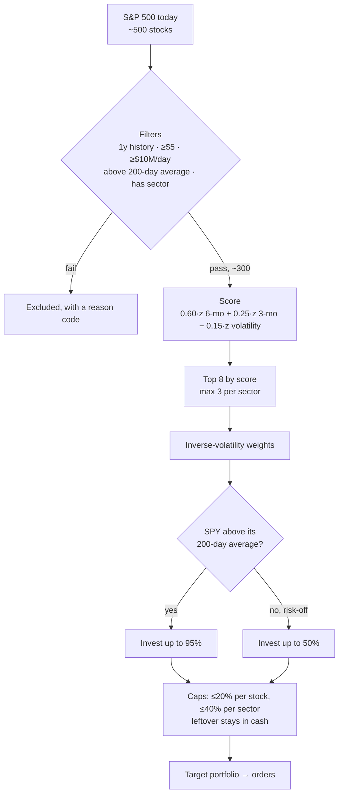
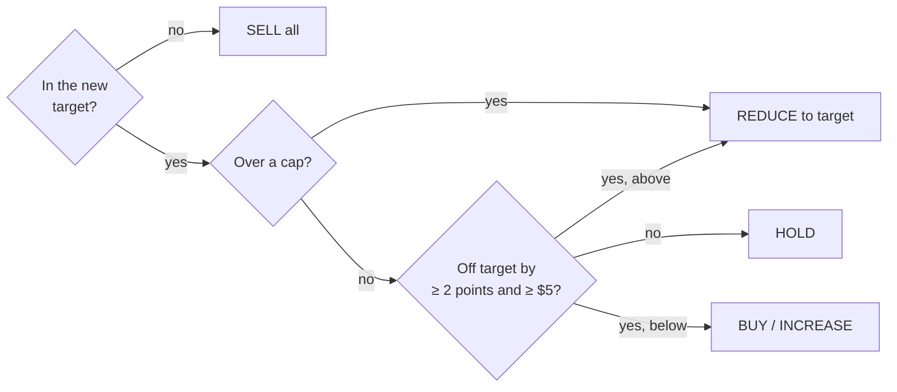
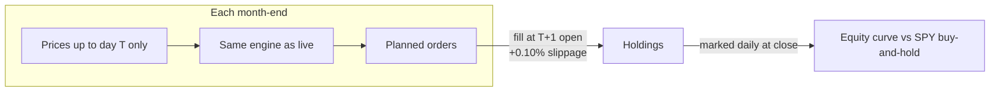

# Strategy: Risk-Adjusted Momentum

**In one line:** own the large US stocks that have been rising the most *steadily*, in a diversified and capped
portfolio, and move to cash when the whole market turns down.

This is a transparent baseline, not a claim that it beats the market. Parameters live in `app/config.py` and were
fixed **before** looking at any backtest. The precise build spec is [`SPEC.md` §4–6](SPEC.md#4-strategy-risk-adjusted-momentum).

## Why momentum?

Stocks that have outperformed over the past 3–12 months have, on average, kept outperforming for a few more months.
This "momentum" effect is one of the most widely documented patterns in markets. Its well-known weakness is that it
can **reverse sharply** when market leadership changes. The rules below try to blunt that: they penalize jumpy stocks,
spread risk across stocks and sectors, and hold cash in downtrends.

## The rules



**1. Universe (what it can buy).** Today's S&P 500 list from Wikipedia, so nothing is hand-picked. A stock must pass all of these:

| Filter | Rule | Why |
|---|---|---|
| History | ≥ 252 trading days (1 year) | Needed to measure momentum and volatility |
| Price | ≥ $5 | Avoids very low-priced stocks |
| Liquidity | Median daily dollar volume ≥ $10M (last 20 days) | Trades would fill near the quoted price |
| Trend | Price above its 200-day average | Don't buy stocks that are falling |
| Sector | Known GICS sector | Needed for the sector cap |

Typically about 300 of the 500 pass.

**2. Score.** Each signal is converted to a z-score: how far the stock sits above or below the eligible average.

```
score = 0.60 × z(6-month return) + 0.25 × z(3-month return) − 0.15 × z(60-day volatility)
```

The 6-month return is the main signal. The 3-month return favors trends that are still going. The volatility term
subtracts a little for wild price swings, so a steady climb outranks an erratic one.

**3. Portfolio.**
- Take the **top 8** by score, at most **3 from any one sector**.
- Weight them by **inverse volatility**: calmer stocks get bigger weights, jumpier ones smaller. That is why a #1-ranked
  but very volatile stock can end up at only ~3%.
- Caps: **≤ 20% per stock** and **≤ 40% per sector**. Any weight the caps can't place stays in cash.
- Always keep **≥ 5% cash**.

**4. Market safety switch.** If SPY is below its 200-day average, the market is treated as being in a downtrend
and the portfolio keeps **at least 50% in cash**.

**5. Trading (turning targets into orders).** For each stock held or targeted:



- A position within **2 percentage points** of its target is left alone (**HOLD**), so small drifts don't cost money.
- Positions that dropped out of the top 8 are **sold** in full; positions over a cap are trimmed.
- Trades under **$5** are skipped.
- Every trade pays **0.10% slippage**; there is no commission.
- Fractional shares are allowed.
- Sells go first and fund the buys; cash never goes negative.

The strategy is long-only, with no leverage, shorting or options.

## How often it runs

- **Live app:** whenever you click *Get recommendation*. It proposes changes relative to what you already hold.
- **Backtest:** once a month, at each month-end close.

## How it is checked



**Backtest (looking back).** The same engine code replays the rules monthly over the past 3 years, or from a
start date you choose. Each decision uses only data available on that day, and orders fill at the **next day's
open**. It is compared with buying and holding SPY. On the bundled data (2023-10-27 → 2026-10-27), $1,000 grows to
about **$4,700 vs $1,900 for SPY**, with a worst drop of **−33% vs −19%**.

**Forecast (looking ahead).** It resamples the last year of daily returns, in 5-day blocks and across all held
stocks together, into 2,000 possible 90-day futures. It reports the middle (median), bad (P10) and good (P90)
outcomes and the chance of a loss, for *applying the trades* vs *keeping what you hold*. Each stock's average
return is replaced with SPY's, so the forecast doesn't assume past winners keep winning. It is a scenario, not a prediction.

## Known weaknesses

- **Momentum crashes.** Trends can reverse quickly. That is why the worst drop is deeper than SPY's despite the
  safety switch, which reacts only after the market has already fallen below its 200-day average.
- **Survivorship bias.** The backtest uses *today's* S&P 500 list, so companies that fell out of the index are
  missing. Treat the backtest as an upper bound.
- **Concentration.** Eight stocks, with up to 40% in one sector, swing more than the index.
- **Prices only.** No fundamentals, earnings or news: it knows *that* a stock moved, not *why*.
- **Not tuned, not validated out of sample.** The parameters are reasonable textbook choices, fixed in advance.
  There is no holdout test.

## Parameters at a glance

| Parameter | Value | Parameter | Value |
|---|---|---|---|
| Momentum windows | 126 and 63 trading days | Max positions | 8 (≤ 3 per sector) |
| Volatility window | 60 trading days | Position cap / sector cap | 20% / 40% |
| Score weights | 0.60 / 0.25 / −0.15 | Cash floor / risk-off cash | 5% / 50% |
| Trend filter | 200-day average | Rebalance band | 2 percentage points |
| Liquidity | $10M median dollar volume (20 days) | Slippage / min trade | 10 bps / $5 |
| Forecast | 90 days, 2,000 paths, 5-day blocks, seed 42 | Backtest | Monthly, next-open fills, 3 years |

*Paper money only. Not investment advice.*
