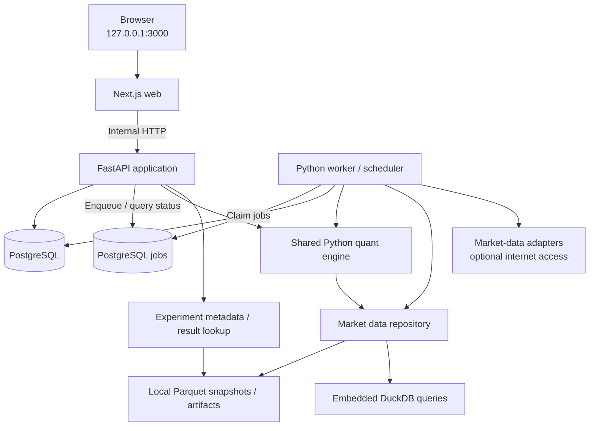

# YAMS — Technology Strategy & Architecture

**Yet Another Market Simulator**  
**Status:** Approved technology-planning baseline  
**Version:** 1.0  
**Date:** October 26, 2026  
**Deployment model:** Single-user, local-first, Docker Compose  
**Companions:** `PRODUCT_STRATEGY.md`, `IMPLEMENTATION_BLUEPRINT.md`, `DOMAIN_AND_API_CONTRACTS.md`, `UX_SPECIFICATION.md`, `../AGENTS.md`

> **Technology thesis:** Keep YAMS simple to run, rigorous enough to trust, and modular enough to evolve. One local application should support strategy research, reproducible backtests, persistent paper portfolios, explainable recommendations, and prospective strategy comparisons—all without cloud infrastructure or real-money trading.

---

## 1. Executive decisions

YAMS is **not a SaaS product**. It runs on one user's machine and works with real or cached market data while all holdings, capital, orders, and executions are **synthetic**.

| Area | Direction | Rationale |
|---|---|---|
| Deployment | **Docker Compose** | Clone, build, and run on a clean machine; persistent local volumes. |
| Application model | **Modular monolith + worker** | Explicit boundaries without distributed-system overhead. |
| Web | **Next.js + TypeScript** | Excellent interactive UI and a familiar agent-friendly frontend stack. |
| UI | **Tailwind CSS + shadcn/ui** | Fast, consistent, accessible application components. |
| Charts | **Plotly.js, lazy-loaded** | Detailed equity curves, risk charts, and experiment comparisons. |
| API | **Python + FastAPI + Pydantic** | Typed contracts adjacent to quantitative computation. |
| Quant engine | **NumPy + pandas + SciPy** | Transparent, testable numerical research and portfolio calculations. |
| Application state | **PostgreSQL + SQLAlchemy + Alembic** | Durable transactional ledger, strategies, jobs, and decision history. |
| Market/history data | **Parquet + embedded DuckDB** | Efficient local columnar research; no analytics server to operate. |
| Long-running work | **Python worker with PostgreSQL-backed jobs** | Backtests and forecasts do not block interactive API requests. |
| Automated tests | **pytest, Vitest, Playwright** | Unit, contract, integration, and user-journey coverage. |
| Packaging | **One monorepo, versioned dependencies** | Simple local setup, isolated agent work, repeatable builds. |

**Firm exclusions:** No users/tenants, signup/login, subscriptions, billing, brokers, real orders, Kubernetes, Redis, Kafka, S3, external managed databases, or cloud-hosting dependency. A local development UI is still a network service: bind it to loopback by default.

The stack above is the **selected implementation baseline**, not a requirement to introduce all libraries or subsystems on day one. Each component should earn its place by supporting a product capability.

---

## 2. Architecture at a glance



**Four long-running containers:** `web`, `api`, `worker`, `postgres`. Database migrations can run as a **one-shot startup task**, not a continuously running fifth service. DuckDB is an embedded library inside Python processes; it is **not a Docker service**.

### Module responsibilities

- **Web:** Navigation, strategy configuration, interactive experiment comparison, portfolio review, risk visualization, trade previews, and journal. It never computes authoritative trades or forecasts.
- **API:** Validates requests, manages strategy versions and portfolio state, submits jobs, serves results, and exposes typed domain operations.
- **Quant engine:** Data eligibility, feature calculation, ranking, target construction, risk policy, synthetic order planning, backtesting, portfolio evaluation, and forecasts. Pure calculations where possible.
- **Worker:** Data refresh, heavy simulations, forecast generation, periodic paper evaluation, progress reports, retries, and cancellations.
- **PostgreSQL:** Source of truth for transactional and auditable application state.
- **Parquet + DuckDB:** Immutable or versioned historical datasets, computed features, equity curves, trade-level artifacts, and efficient analytical queries.

**Architecture rule:** The backtester, portfolio recommendation engine, and Strategy Arena must call the **same strategy evaluation, risk, allocation, and execution-policy code**. They may vary the clock and data source but must not duplicate decision logic.

---

## 3. Local developer and user experience

### Primary workflow

```bash
# After the repository has been implemented:
git clone <repository-url>
cd yams
cp .env.example .env    # Optional; documented defaults should work without edits
docker compose up --build
# Open http://localhost:3000
```

A new user should encounter a seeded **demo workspace and sample experiment** on first boot, with sample data clearly labeled. They can then ingest fresh market data, create or fork strategies, run experiments, create a $1,000 paper portfolio, and evaluate ongoing recommendations.

### Operational requirements

1. **One-command first run:** Start services; check dependencies; run schema migrations; seed idempotently; present healthy app.
2. **Durability:** Postgres data and research artifacts use named Docker volumes. Container rebuilds do not destroy portfolios or past experiments.
3. **Offline mode:** Fixtures, previously cached data, and saved results remain browsable and rerunnable without internet. New market refreshes fail with an actionable message.
4. **Reset and backup:** Document export/backup and a separate, deliberately destructive `reset` command; never reset data during ordinary startup.
5. **Developer mode:** `make dev` or equivalent launches only infrastructure in Docker while web/API/worker run natively with hot reload. Full-container mode remains authoritative.
6. **No account setup:** Single local workspace, multiple strategies and multiple independent paper portfolios. No authentication UI.
7. **Controlled resources:** Bound worker concurrency and experiment workload; configurable time, memory, ticker, and historical-range limits.
8. **Networking:** Publish only the web port on `127.0.0.1` by default. API/Postgres are private to the Compose network. Document the risks of intentionally exposing the app beyond localhost.
9. **Health/diagnostics:** Display market-data freshness, last evaluation, job failures, dataset coverage, and disk usage within the app.
10. **Configuration:** Non-secret defaults in source; secrets in ignored `.env` and Docker environment; meaningful, validated config errors.

No container should require AWS credentials, a paid market-data subscription, or an LLM API key to demonstrate the core product.

---

## 4. Source-of-truth and data architecture

### PostgreSQL: durable domain state

Minimum entities (schemas evolve through migrations):

| Entity | Key responsibility |
|---|---|
| `strategy` / `strategy_version` | Human identity; immutable, validated versioned rule configurations. |
| `dataset_snapshot` | Provider, coverage, point-in-time limitations, content hashes, file references. |
| `experiment_run` | Status, strategy version, snapshot, date ranges, execution assumptions, seed, metrics and artifacts. |
| `paper_portfolio` | Starting cash, deployed strategy version, active policy, benchmark. |
| `paper_order` / `paper_fill` | Proposed and simulated execution events and their prices/costs. |
| `cash_ledger_entry` / `position_event` | Reconstructible account activity; holdings as a derived state or audited projection. |
| `recommendation` | Current holdings, proposed targets, action deltas, explanations, input snapshot and timestamp. |
| `forecast` / `decision_outcome` | Numerical horizon estimates, uncertainty, eventual realized observations and counterfactual. |
| `arena` / `arena_entrant` | Frozen strategy competitors, independent accounts and evaluation rules. |
| `job` | Type, status, parameters, progress, heartbeat, attempts, results and cancellation state. |

Use transaction boundaries for money-like operations. **Cash movements and simulated fills must reconcile atomically**; use a fixed monetary precision/decimal representation for dollars and share quantities rather than floating-point balances. Numerical strategy statistics may use floating point, with documented tolerances.

### Parquet + DuckDB: analytical state

Recommended local directory convention:

```text
data/
  fixtures/                # Committed, small deterministic example data
  market/                  # Cached source datasets (volume-mounted)
  snapshots/<snapshot-id>/ # Immutable dataset manifests and partitions
  experiments/<run-id>/    # Metrics, equity curves, holdings, trade histories
  exports/                 # User-triggered backups and reports
```

Use **content-addressed or manifest-identified snapshots**. Store file hashes, source, refresh time, symbol coverage, schema version, currency, timezone, price basis, and known quality limitations. Publish files atomically (write temporary, validate, rename). A single worker initially manages writes to shared snapshots; readers query immutable versions.

Do **not** store bulk daily price bars or long equity curves as thousands of transactional rows unless a specific interactive query needs them. Do **not** treat filenames alone as durable experiment provenance.

### Data-provider boundary

Expose a provider interface for:

- Asset identifiers and sector/industry metadata.
- Historical OHLCV and corporate actions (splits/dividends).
- Benchmark series and exchange calendar.
- Optional fundamentals and contextual signals, **with their actual availability dates**.
- Coverage, rate-limit, license, timestamp, and failure metadata.

**Initial adapters:** deterministic local fixtures, a local Parquet cache, and an optional Yahoo Finance research adapter such as `yfinance`. Public data sources and their terms may change; treat this as an educational, local-research integration and review provider restrictions before distributing datasets.

The adapter must never pretend missing fundamentals, historical constituents, or provider outages were successfully resolved.

### Point-in-time correctness

For each field, distinguish **economic date** (period represented), **published/available time** (when a strategy could know it), and **ingestion time** (when YAMS obtained it). At the end of a trading session, a strategy may use only available historical evidence and is filled according to an explicit later-session paper execution model.

Use exchange-local session calendars (U.S. equity market initially), while storing all event timestamps in UTC. Define precise as-of and half-open date interval semantics. Document behavior around weekends, holidays, splits, delistings, missing symbols, and unavailable historical universe membership.

**Critical distinction:** Adjusted prices may be appropriate for return/feature calculations, while synthetic order fills require a coherent unadjusted price/corporate-action policy. Prevent double-counting dividends or splits. Mark survivorship-biased universes and incomplete corporate-action handling prominently until accurate point-in-time sources are supported.

---

## 5. Strategy and investment-engine design

### Declarative, immutable strategies

Strategy definitions are **validated configuration**, not runtime-evaluated Python snippets or untrusted executable code. Once referenced by an experiment, recommendation, or Arena entrant, a version is immutable; editing creates a new version.

Illustrative configuration (contract will be versioned):

```json
{
  "schema_version": 1,
  "name": "Risk-Adjusted Momentum",
  "universe": {"id": "liquid_us_equities", "minimum_price": 5},
  "ranking": {"kind": "momentum_volatility", "lookback_sessions": 126},
  "allocation": {"method": "inverse_volatility", "max_positions": 8},
  "risk": {
    "max_single_position_weight": 0.20,
    "max_sector_weight": 0.40,
    "allow_cash": true
  },
  "rebalance": {"frequency": "monthly", "minimum_trade_value": 5}
}
```

This example is a **schema illustration**, not proof that its particular parameters are effective.

### Single decision contract

```text
strategy_version + dataset_snapshot + as_of + portfolio_state + execution_policy
    -> eligible candidates and quality flags
    -> feature values and transparent rankings
    -> target portfolio and constraints report
    -> paper order preview and plain-language evidence
```

Implementation interfaces should separate:

1. **Universe and eligibility:** Dynamic candidate discovery from a defined, non-hand-picked asset pool; liquidity, history, and missing-data rules.
2. **Feature engineering:** Reusable momentum, volatility, trend, and later fundamental features with explicit as-of behavior.
3. **Strategy scoring:** Reproducible rankings and selected candidates; reject invalid inputs and nonfinite values.
4. **Portfolio construction:** Dynamic weights, max positions, caps, cash fallback, position-size/sector rules.
5. **Risk assessment:** Concentration, volatility, estimated downside, turnover, and constraint violations.
6. **Order planning:** Convert target weights into BUY/SELL/HOLD actions, dollar amounts, fractional quantities, costs and cash effects.
7. **Synthetic execution:** Apply timing/slippage/fees and create auditable ledger events, with no real brokerage route.
8. **Explanation:** Generate text **from measured signals and applied rules**, with traceable evidence identifiers.

### Engine invariants

- No look-ahead data or same-bar execution on information only known after that bar.
- No leverage, negative cash, short positions or unauthorized asset types in initial releases.
- Targets sum to no more than 100%; any remainder is an explicit cash allocation.
- Every proposed trade is cash/quantity feasible under rounding and cost rules.
- Applying the same execution event twice does not double-post a fill.
- Backtesting and ongoing paper decisions use identical domain logic and documented policy differences.
- A HOLD decision is valid when no trade offers sufficient benefit or constraints prevent change.

---

## 6. Research workflows and experiment integrity

### Backtesting

Use a **walk-forward, event-based portfolio backtester** with a shared strategy contract:

```text
For each scheduled decision date:
  load evidence available as of that date
  evaluate candidate universe and strategy
  construct constrained target portfolio
  plan and execute synthetic trades at the specified next eligible price
  account for costs, cash, corporate actions and portfolio value
  persist trades, positions, equity curve and diagnostics
```

Every completed run reports cumulative/annualized return where meaningful, maximum drawdown, volatility, Sharpe ratio with documented risk-free convention, turnover, transaction costs, benchmark-relative performance, and sample limitations. Clearly separate in-sample exploration from an untouched out-of-sample holdout. Preserve experiment failures and warnings rather than displaying partial outputs as complete successes.

### Forecasting and recommendations

For a stated horizon (default **90 calendar days**, mapped into trading sessions), generate a **numerical** forward-looking scenario: estimated median or expected return (label which), projected paper portfolio value, downside/upside percentiles, and probability of loss. Compare the **recommended target** against **holding the existing portfolio** under the same model and assumptions.

A baseline may use a reproducible historical-return bootstrap with a recorded lookback, block length (if any), iteration count, and random seed. Call it a **scenario estimate, not a reliable prediction**; never label a generic empirical quantile as a calibrated confidence interval without validation. Track realized outcomes over time.

Recommendations must include exact simulated action, amount/quantity, current vs proposed weight, constraint impacts, reason, market-data timestamp, strategy version, and forecast horizon. A newly opened portfolio must support an initial recommendation from a documented default strategy without requiring users to build one first.

### Strategy Arena and Journal

The Arena gives each entrant an independently simulated paper portfolio with the **same starting capital, start time, market calendar, costs, and evaluation horizon**. Entrant strategy versions are frozen. Challenger promotion is explicit, not automatically determined by the best recent return. Benchmarks are evaluated under consistent conventions.

The Journal stores **what was known**, **what was recommended**, **what was simulated**, **what was forecast**, and **what later occurred**. Outcome measurement must not overwrite prior forecasts. Support comparison against no-change and passive benchmark counterfactuals.

---

## 7. API and asynchronous jobs

### API conventions

Use `/api/v1` routes, Pydantic validation, OpenAPI schemas, generated TypeScript client types, consistent error envelopes, stable resource IDs, and pagination on expanding histories. Representative routes:

```text
GET    /api/v1/health
GET    /api/v1/data/snapshots
POST   /api/v1/data/refresh
GET    /api/v1/strategies
POST   /api/v1/strategies
POST   /api/v1/strategies/{id}/versions
POST   /api/v1/experiments
GET    /api/v1/experiments/{id}
GET    /api/v1/jobs/{id}
GET    /api/v1/portfolios
POST   /api/v1/portfolios
POST   /api/v1/portfolios/{id}/recommendations
POST   /api/v1/recommendations/{id}/apply
GET    /api/v1/portfolios/{id}/recommendations
GET    /api/v1/journal
GET    /api/v1/arenas
```

These are **representative routes**; the authoritative endpoint list and exact request/response semantics are in `DOMAIN_AND_API_CONTRACTS.md`. Generate a versioned OpenAPI specification and TypeScript client before parallel UI/API agent work.

### Background-job policy

Use a PostgreSQL job table and a small dedicated worker. Atomically claim pending jobs (`FOR UPDATE SKIP LOCKED` or a supported library), persist progress, provide heartbeats, handle cancellation cooperatively, and apply bounded retries with backoff only to transient failures. Use idempotency keys for data refresh, repeated portfolio evaluation, and synthetic fills.

Recommended job classes: market refresh, backtest, scenario forecast, scheduled portfolio evaluation, Arena evaluation, and journal outcome maturation. The worker owns a lightweight local scheduler; **scheduled work happens only while YAMS is running**, with safe catch-up on restart. Never claim always-on monitoring when the Docker application is stopped.

Start with **one worker process and bounded concurrency**. Add Redis or distributed execution only if measured workloads justify it—there is no default need for either.

### Failures and observability

Structured JSON logs and correlation IDs should link an API request to job, run, dataset snapshot, and strategy version. Display actionable statuses (`queued`, `running`, `completed`, `failed`, `cancelled`) and quality warnings in the interface. Track durations, failed jobs, cache age, datasets, and disk consumption locally; no external telemetry destination by default.

---

## 8. Repository and deployment conventions

```text
yams/
├── apps/
│   └── web/                    # Next.js, UI, charts, generated API client
├── backend/
│   ├── api/                    # FastAPI routers and application services
│   ├── domain/                 # Typed entities and contracts
│   ├── market_data/            # Providers, provenance and local cache
│   ├── strategies/             # Universe, features, scoring
│   ├── portfolio/              # Allocation, risks, ledger, paper fills
│   ├── backtesting/            # Walk-forward engine and metrics
│   ├── forecasting/            # Return scenarios
│   ├── arena/                  # Parallel paper competitions
│   ├── journal/                # Decisions, outcomes, counterfactuals
│   ├── jobs/                   # Queue, scheduler and workers
│   ├── persistence/            # SQLAlchemy models and migrations
│   └── tests/
├── data/
│   └── fixtures/               # Minimal checked-in reproducible data
├── docs/
│   ├── PRODUCT_STRATEGY.md
│   ├── TECHNOLOGY_STRATEGY.md
│   └── adr/
├── infra/
│   └── docker/                 # Container build and entrypoints
├── compose.yaml
├── .env.example
├── Makefile
├── AGENTS.md
└── README.md
```

**Dependency hygiene:** Python dependencies locked using a single package manager; Node package lock committed; base images pinned by version (digest for release builds). Keep the shared Python engine importable by API and worker and unit-testable without a running web server.

**Docker volumes:** Named volume for PostgreSQL and separate named volume for market snapshots / experiment artifacts. The fixture set is repository-owned and read-only in production-mode containers. Compose health checks gate API readiness and migrations. Make no externally reachable API/database ports by default.

**Secrets and local safety:** No secrets in Git or build layers; `.env` ignored; no arbitrary Python evaluation from strategy input; no real broker SDK/credentials; input validation on URLs, file paths, queries and experiment budgets. Clearly label all simulated trading and forecasts in the interface.

---

## 9. Testing and quality gates

| Test level | Mandatory examples |
|---|---|
| Quant unit | Ranking determinism, missing data, volatility, weights sum, caps, cash buffer, no negative holdings. |
| Accounting property tests | Ledger conservation, duplicate fill idempotency, fees and rounding, split/dividend policies. |
| Backtest temporal tests | Look-ahead prevention, next-bar execution, holiday alignment, benchmark fairness, leakage regressions. |
| Forecast tests | Stable seeded runs, horizon conversion, valid percentiles, no future information. |
| Persistence/integration | Alembic migrations, Docker Postgres, job claiming/retries, restart recovery, snapshot checksums. |
| API contract | OpenAPI compatibility, validation errors, pagination, job lifecycle and status. |
| Frontend unit | Correct labels, disclosure states, strategy form validation, consistent numeric/currency formatting. |
| E2E | Fresh boot → default recommendation → backtest → synthetic deployment → evaluation → journal. |
| Offline acceptance | App starts without API keys; sample experiment works without network; missing live data is clearly indicated. |

Use **golden datasets and expected trade/ledger outputs** checked into the repository. CI must run formatting, linting, type checking, fast tests, API contract checks, and a small Docker end-to-end smoke test. Heavy research performance benchmarks can run separately.

**Definition of done for any financial-code change:** New/updated tests, stable rerun on fixtures, explicit assumptions and limitations, no regression to reconciliation or time semantics, and an inspectable example result.

---

## 10. Delivery sequence and architectural gates

Technology work should follow the product roadmap, with a usable vertical slice before advanced features.

| Milestone | Architecture deliverable | Engineering exit gate |
|---|---|---|
| **0.0.1 — Foundation** | Monorepo, Compose, frontend/API/worker skeleton, schema/migrations, fixtures, CI, `AGENTS.md`. | Fresh clone launches local UI and passes tests. |
| **0.0.2 — Market Data & Quant Core** | Providers, provenance, Parquet snapshots, universe, features, scoring and allocation/risk interfaces. | Given as-of inputs, engine produces repeatable scored candidates and feasible targets. |
| **0.0.3 — Strategy Lab & Backtesting** | Immutable strategy versions, backtest runner, job status, benchmark and comparative UI. | Same inputs produce the same outcomes; temporal/leakage tests pass. |
| **0.0.4 — Paper Portfolios** | Durable paper ledger, order preview, execution model, valuations. | Portfolio remains correct after restart; cash/positions reconcile. |
| **0.0.5 — Decision Center** | Rebalance logic, evidence-grounded recommendations, 90-day scenario baseline. | Complete requirements: current position, next-action proposal, numerical forecast, history and explanations. |
| **0.0.6 — Strategy Arena** | Independent competitor portfolios, scheduled evaluations, fair comparisons. | Frozen entrants compete on aligned terms. |
| **0.0.7 — Decision Journal** | Immutable decision snapshots, outcome maturation, counterfactuals. | Prior predictions and outcomes are inspectable and independently reproducible. |
| **0.0.8 — Assisted Authoring** | Visual composer, optional AI-to-strategy proposal validated by schema. | AI proposes configurations; deterministic engine remains authority. |
| **0.0.9 — Reliability & Research Depth** | Provider hardening, richer context, exports/backups, local diagnostics and performance tuning. | Realistic datasets remain usable and failures remain observable/recoverable. |

**Core product release = 0.0.1–0.0.5.** 0.0.6–0.0.9 are additive, not prerequisites for an end-to-end first release. There is **no migration-to-SaaS milestone**.

### GitHub and coding-agent conventions

- Plan work as **Milestone → Epic → Issue → PR**, with acceptance criteria, dependencies, interface definitions, fixtures, and required tests in each issue.
- Write interface/contract issues before parallelizing API, engine, worker and UI work. Prefer vertical slices and small PRs over cross-cutting rewrites.
- Place agent rules in `AGENTS.md`: do not fabricate market results, silently change investment assumptions, add broker integrations, or bypass test gates.
- Require architecture decision records for changes to ledger semantics, trade timing, price adjustments, queue design, snapshot provenance, and forecasting approach.
- Do not create product claims from unverified backtests. Label demo/fixture content as illustrative.

---

## 11. Architecture decisions and open implementation choices

### Decided

- Single-user, local-only Docker deployment; no SaaS, authentication or cloud dependencies.
- Next.js web frontend and Python FastAPI/quant backend; independent background worker.
- PostgreSQL for operational state; local Parquet plus embedded DuckDB for analytical data.
- Reusable, deterministic strategy engine; paper-only trading; immutable research lineage.
- Data adapters isolate external providers; local fixtures support fully offline startup.

### Decisions baselined by the implementation blueprint; record as focused ADRs

1. **ADR-001: Paper execution semantics** — close-to-next-open timing, slippage, fees, fractional shares, settlement/cash treatment and holidays.
2. **ADR-002: Data normalization** — OHLCV, corporate actions, adjusted vs executable price, constituent point-in-time coverage and source fallback.
3. **ADR-003: Strategy configuration schema** — versioning, allowed feature operators, validation and extension points.
4. **ADR-004: Portfolio ledger** — cash/position invariants, event vs projection tables and atomicity.
5. **ADR-005: Worker queue** — minimal Postgres job implementation vs a small maintained queue library, lifecycle and cancellation.
6. **ADR-006: Forecast baseline** — 90-day scenario horizon, bootstrap convention, assumptions and comparability.
7. **ADR-007: Dataset manifests** — canonical snapshot format, hashing, retention and backup/export behavior.

The concrete starting policies for these seven decisions are in `IMPLEMENTATION_BLUEPRINT.md`; encode them as ADRs in 0.0.1 and do not re-decide them independently in coding-agent PRs. Changes require an ADR, updated tests, and synchronized contract changes.

---

## 12. Definition of technical success

A fresh clone can start YAMS locally through Docker without account registration, paid services, or additional runtime installation. The web application can load a clearly labeled sample dataset (and optionally refresh real market data), dynamically select and score securities, backtest a strategy with defensible historical timing, persist a $1,000 synthetic portfolio, explain its holdings and next BUY/SELL/HOLD decisions, and show a numerical return scenario over a stated horizon. Strategies and dataset snapshots are versioned; simulations are repeatable; virtual cash and positions reconcile; jobs are observable; and restarts do not erase state.

**North star:** Every YAMS recommendation can be traced to a strategy version, a market-data snapshot, an explicit decision rule, a simulated portfolio action, and eventually an observed paper outcome.

**Never crossed:** Real-money trading, concealed future-data leakage, fabricated forecasts, or requirements for hosted services.

## 13. Contract and Ownership Precedence

Single-user Docker deployment is permanent product scope, not a staging step toward SaaS. One-command offline startup and safe paper-only behavior are core acceptance criteria.

- `PRODUCT_STRATEGY.md`: why, capabilities, functional IDs, milestone outcomes.
- `TECHNOLOGY_STRATEGY.md`: infrastructure, modules, local operations, persistence split.
- `IMPLEMENTATION_BLUEPRINT.md`: initial provider, quant rules, timing, accounting, forecast and benchmark policies.
- `DOMAIN_AND_API_CONTRACTS.md`: entities, request/response formats, error envelopes, transitions, idempotency.
- `UX_SPECIFICATION.md`: user-visible interactions and state treatment.
- `../AGENTS.md`: implementation workflow and PR gates.

Where examples disagree with **normative** contracts, the appropriate normative document controls. Propose changes through tracked ADRs and update all impacted documents, fixtures, and API tests.
