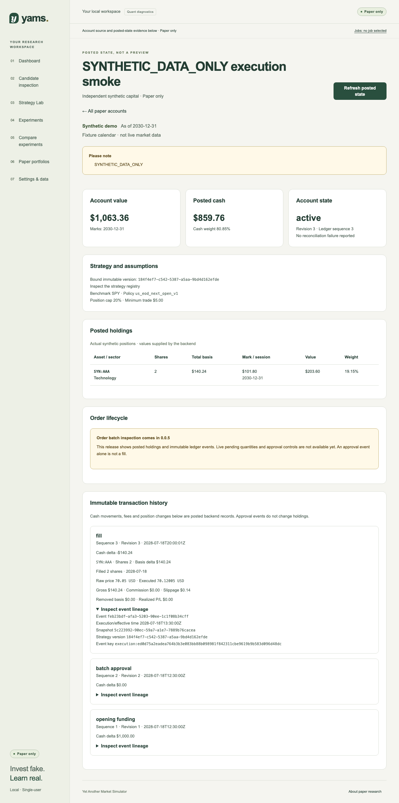

# Portfolio screen verification (#47)

This increment adds cash-account creation/list/detail, backend-owned valuation,
posted holdings and ledger inspection to 0.0.4. Public approval/batch transport
remains staged for 0.0.5. All screenshots and financial fixtures below are
`SYNTHETIC_DATA_ONLY`; they contain no downloaded/licensed market data.

## Verification scope

The production-build Playwright suite exercises 1280 px and 360 px, keyboard forms,
Axe, exact backend values, missing/stale marks, independent source filtering,
validation, original-key/body recovery after a committed-but-unacknowledged
creation, pagination, unknown accounts and long names. The typed pending-batch
component is rendered separately from application routes with production CSS;
terminal partial shortfall is distinguished from genuinely pending intent.

The full Docker journey additionally exercises the real same-origin proxy,
PostgreSQL funding, immutable version binding and supervised private synthetic
fills. Browser inspection/retry after restart and rebuild verifies durable
identity, funding, holdings and history. Existing diagnostics, strategy editing,
backtests/comparisons and offline/migration recovery remain covered.

## Passed checks

- Backend: 406 tests; new authored transport fixtures validate against Python models
  and independent FIX-03 money/share/weight expectations.
- Frontend: 66 unit tests, strict TypeScript, ESLint/Prettier and production build.
- Browser: 62 full-suite cases at 1280 px and 360 px; final focused 18 portfolio cases also
  pass after mobile table/copy refinements. Axe reports no violations.
- Ruff/format, strict Python typing, unchanged OpenAPI/generated-client drift,
  30 canonical fixtures, 70 Markdown content/local links and whitespace review pass.
- `make smoke`: 21 checks pass in owned project `yams-smoke-0af4f7caef62`.
  Two actual browser-created accounts remain independently $1,000 cash with one
  funding event each. Original keys recover the same identities after restart
  and rebuild. Actual private-service-seeded fills retain cash $859.76, two shares,
  basis $140.24, raw 70.05/executed 70.12005, commission $0 and slippage $0.14.
  Backend marks yield value $1,063.36; the browser displays those supplied values.
  Both widths pass keyboard, overflow and Axe checks; external requests/page
  errors are absent. All owned containers/volumes are removed afterward.

The backend financial runtime and schema are unchanged. The existing PostgreSQL
crash/replay/migration/resource proofs remain with #44–#46; CI also repeats the
normal runtime gates. This PR does not publish the 0.0.4 release.

## Actual Docker screenshots

These screenshots come from the real browser/proxy/database/worker journey,
including inspection after rebuild. They show only owned synthetic inputs.

[Cash account — desktop](cash-desktop.png) · [Cash account — mobile](cash-mobile.png)

[Posted account — desktop](posted-desktop.png) · [Posted account — mobile](posted-mobile.png)

Operational behavior and scope are described in
[the screen handoff](../../operations/paper-portfolios.md).
